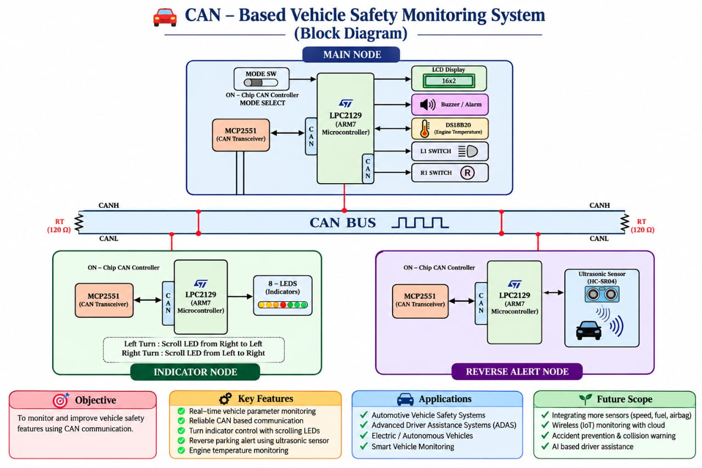
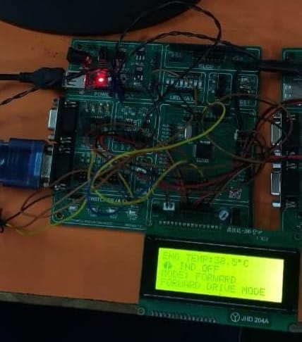
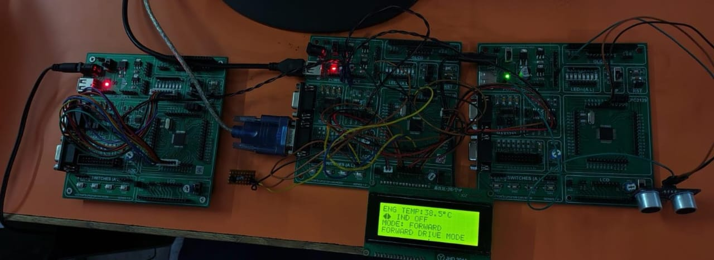
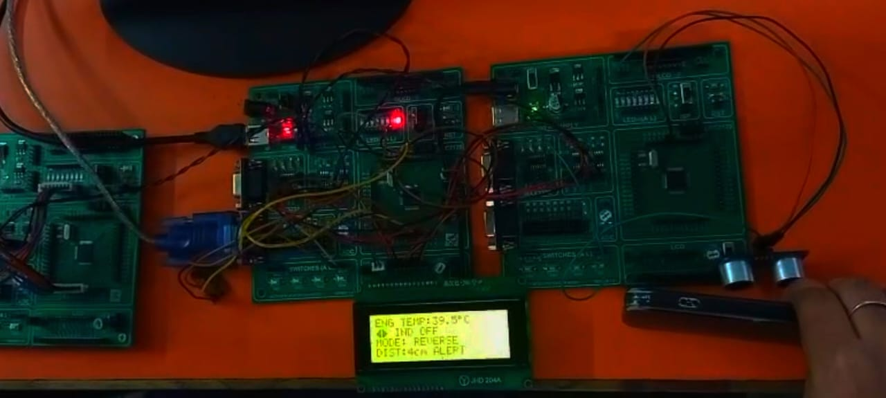
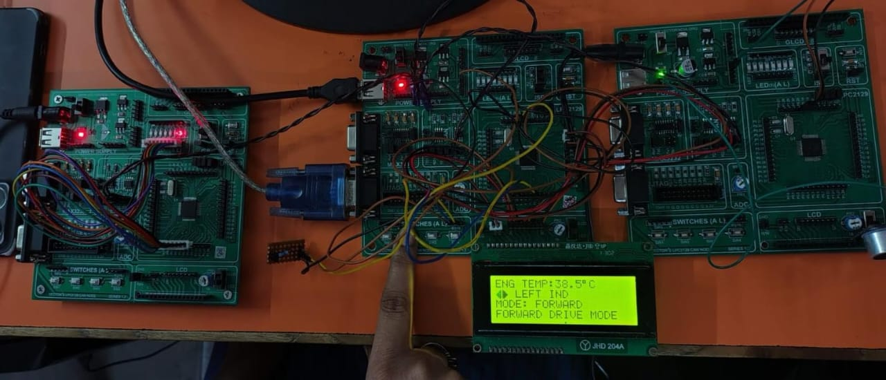
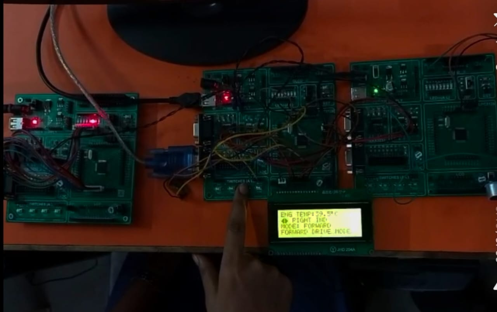

# CAN-Based Vehicle Monitoring and Reverse Safety System

## Overview

This project is a three-node embedded system developed using the LPC2129 ARM7 microcontroller and Embedded C.

It uses the CAN (Controller Area Network) protocol for communication between nodes to monitor vehicle temperature, control indicators, and detect obstacles during reverse mode.

## Features

- Engine temperature monitoring using DS18B20
- CAN communication between three nodes
- Left and right indicator control
- Forward and reverse mode selection
- Ultrasonic obstacle detection
- LCD status display
- Buzzer-based reverse warning
- Eight-LED indicator sequence

## System Architecture

### Node 1 – Main Node
- Reads engine temperature.
- Displays vehicle status on LCD.
- Handles indicator and mode switches using external interrupts.
- Sends CAN commands.
- Activates the buzzer when an obstacle is detected in reverse mode.

### Node 2 – Indicator Node
- Receives indicator commands through CAN.
- Controls eight LEDs for left and right indicator sequences.

### Node 3 – Reverse Alert Node
- Measures obstacle distance using an ultrasonic sensor.
- Detects obstacles within the 20 cm threshold.
- Sends distance and alert status to the Main Node through CAN.

## Hardware Requirements

- LPC2129 ARM7 Microcontroller – 3
- MCP2551 CAN Transceiver – 3
- DS18B20 Temperature Sensor – 1
- HC-SR05-compatible Ultrasonic Sensor – 1
- LCD Display – 1
- LEDs – 8
- Buzzer – 1
- Switches – 3
- CAN Bus Wiring

## Software and Tools

- Embedded C
- Keil µVision
- Flash Magic
- CAN Protocol

## CAN Message IDs

| CAN ID | Function |
|---|---|
| `0x101` | Indicator Control |
| `0x102` | Forward/Reverse Mode |
| `0x201` | Obstacle Distance and Alert |

CAN Bit Rate: **125 kbps**

## Working Principle

1. The Main Node monitors engine temperature and displays it on the LCD.
2. Indicator switch commands are transmitted through CAN.
3. The Indicator Node controls the LED sequences.
4. The mode switch selects Forward or Reverse mode.
5. In reverse mode, the ultrasonic sensor measures obstacle distance.
6. If an obstacle is detected within 20 cm, an alert message is sent to the Main Node.
7. The Main Node activates the buzzer to warn the driver.

## Project Output

### Hardware Setup

### Forward Mode

### Reverse Alert

### Left Indicator

### Right Indicator

## Applications

- Automotive Embedded Systems
- CAN-Based Communication
- Vehicle Monitoring
- Reverse Parking Assistance

## Future Improvements

- CAN error handling
- Sensor fault detection
- Improved obstacle detection
- Real-time vehicle data logging

## Conclusion

This project demonstrates CAN-based communication between multiple embedded nodes using LPC2129 ARM7 microcontrollers. It integrates temperature monitoring, indicator control, ultrasonic obstacle detection, and driver alerts using Embedded C.

**Note:** This project is an educational prototype and is not intended for production automotive safety applications.
